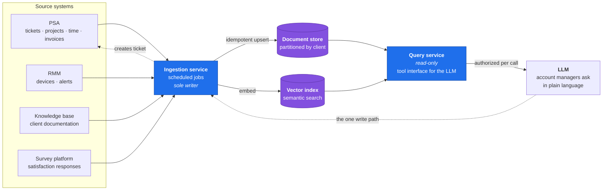
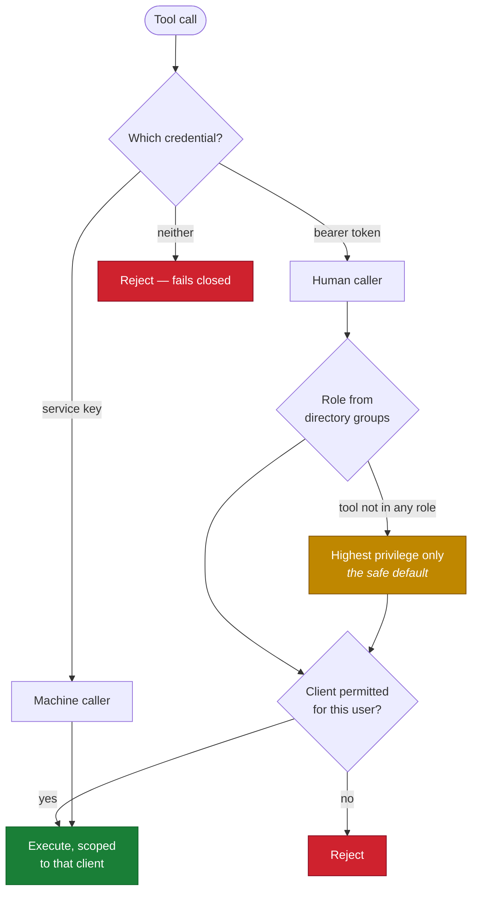

# Client Intelligence Platform

**An architecture case study.** A data platform that continuously reconciles four disconnected
operational systems into one queryable model, and exposes it to an LLM so account managers can
ask questions in plain language and get answers grounded in real numbers.

Built and operated in production at a managed service provider. This repository documents the
architecture and the reasoning behind it. It contains **no source code, no configuration, no
schemas and no operational detail** — see [NOTICE](NOTICE.md).

---

## The problem

A managed service provider's operational reality lives in systems that do not talk to each
other. Tickets, projects and invoices in the PSA. Endpoint monitoring in the RMM. Client
documentation in a separate knowledge base. Satisfaction surveys somewhere else again.

An account manager preparing for a client conversation had to open all four and reconcile them
by hand. The question "how is this client actually doing" took an afternoon, was answered
inconsistently by different people, and was stale by the time it reached the meeting.

The obvious answer — a dashboard — had already been tried. Dashboards answer the questions you
anticipated. The questions that matter before a client conversation are the ones you did not.

## What was built

Roughly: 21 scheduled jobs running from every five minutes to monthly, ~16 logical collections,
~35 read-only tools exposed to the LLM, around 1,200 tests. Ingest lag runs from a few minutes
to about fifteen depending on the source.

The interesting part is not the box diagram. It is five decisions that shaped everything else.

---

## Decision 1 — One writer, enforced structurally

Two services share one database. **Only one of them can write.** The query service the LLM talks
to is read-only, and its single write path — creating a ticket — calls back through the
ingestion service's HTTP interface rather than touching the database directly.

This looks like indirection for its own sake until something goes wrong. When a number is wrong,
there is exactly one component whose code could have produced it. No bisecting between two
services, no "which one wrote this document last."

It also means a defect in the conversational layer — the part driven by a language model,
handling untrusted text, changing fastest — cannot corrupt the record.

[Full decision record →](docs/decisions/0001-single-writer-boundary.md)

## Decision 2 — Compute scores at read time, never store them

The platform originally persisted an account health score per client. That was built, shipped,
and then **deliberately deleted**.

A score frozen at write time silently stops being true as the inputs behind it move. Nothing
surfaces the drift. Someone opens a client record six weeks later, sees a B, and acts on a
number that was computed against facts which no longer hold.

The platform now stores only raw signals — counts, percentages, dates — and composes any score
at the moment it is asked for, where the inputs are visible alongside the result. Raw signals
age honestly. A stored score does not.

This is the decision I would defend hardest in an interview, because it meant deleting working
code that people liked.

[Full decision record →](docs/decisions/0002-compute-at-read-time.md)

## Decision 3 — Lag the watermarks on purpose

Each ingestion source tracks how far it has read using a watermark stored alongside the data it
describes. The obvious implementation stores the true maximum timestamp seen.

That implementation loses records. A source system can update a row mid-pass, after you have
read past its position but before you finish. With an exact watermark, the next run starts after
it and the update is gone forever, silently.

So the watermark is stored **deliberately behind** the true maximum. Consecutive runs overlap
and re-read the same records. Correctness comes from upserts being idempotent, not from perfect
bookkeeping.

Trading a little redundant work for the elimination of an entire class of silent data loss is
almost always the right trade in ingestion.

[Full decision record →](docs/decisions/0003-lagging-watermarks.md)

## Decision 4 — Two writers, one document, no locks

One document per client is the aggregate everything downstream reads. Two independent processes
own different halves of it, on different schedules, and neither knows the other's fields.

The failure mode is brutal and silent: a plain write from one process discards the other's
fields entirely. No exception, no log line. Fields simply stop updating, and nobody notices for
weeks.

The fix is an etag-guarded read-merge-write, applied through a single shared function that is
the only sanctioned way to touch that document. Optimistic concurrency, no distributed lock, no
coordination between the two schedules.

The engineering lesson is narrower than the pattern: when a shared mutable structure has more
than one owner, the discipline has to live in code that is hard to bypass, not in a convention
written down somewhere.

[Full decision record →](docs/decisions/0004-concurrent-writers.md)

## Decision 5 — Authorize every call, on two axes

The query service is stateless and runs multiple replicas, so there is no session to attach an
authorization decision to. Every tool invocation is checked independently against two axes:
**what role the caller holds**, and **which clients they are permitted to see**.

The detail that matters most: **a newly added tool is restricted to the highest privilege tier
until someone deliberately grants it wider access.** Forgetting to configure a permission
produces a tool nobody can call, rather than a tool everybody can call. The failure direction is
chosen, not accidental.

This platform holds a continuously refreshed mirror of an entire book of business. An
authorization defect is a cross-client data exposure, not an inconvenience.

[Full decision record →](docs/decisions/0005-per-call-authorization.md)

---

## Operating it

Three practices did more for reliability than any amount of design:

**Quarantine, don't retry blindly.** A record that will not write goes to a dead-letter
collection. A rising dead-letter count became the earliest available signal that an upstream
system had changed shape — usually days before anyone noticed missing data.

**Budget every job, and checkpoint inside it.** The serverless host kills a run at ten minutes.
Jobs take a time budget and checkpoint as they go, so a kill costs one page of work rather than
one pass. Without this, a job that grew past the limit would fail forever and silently.

**Make the invariants executable.** Constraints that live only in documentation get violated.
The ones that survived were the ones with a test asserting them — including a test that a
scheduled job's configured interval matches the constant derived from it, after changing one
without the other disabled a downstream recomputation for two weeks.

[What broke, and what it taught →](docs/incidents.md)

---

## What I would do differently

**Type the tool responses from the start.** The tool interface describes its return shapes in
prose docstrings. That makes drift between the store and the tool layer impossible to assert
mechanically — I could not build the contract test I wanted, because there was nothing
machine-readable to check against. Typed response models from day one would have cost a day and
saved that permanently.

**Separate the ingestion framework from the sources earlier.** Each source was implemented with
its own pagination, watermark and retry handling. They converged on the same shape, but only
after the fourth one, by which point the duplication was load-bearing and consolidating it
became its own project.

**Treat documentation paths as a build dependency.** Source comments cited documentation files
by path. Reorganizing the docs quietly invalidated a dozen of those pointers, because no test
and no compiler knows a comment is a reference. I ended up writing a
[link checker](https://github.com/Jaswanthnani02/doc-link-check) to close that gap.

**Decide the scoring question earlier.** Building stored scores, operating them, discovering they
rot, and removing them cost more than starting from raw signals would have. The reasoning that
led to the removal was available before the code was written; I just had not thought it through.

---

## Stack

Python. Serverless functions for scheduled ingestion. A container-hosted HTTP service for the
query layer. A partitioned document store. A managed vector index for semantic search over
documentation. Directory-based SSO with OAuth and PKCE. GitHub Actions for CI and deployment.

Vendor-neutral by description on purpose — the patterns here are not specific to any one cloud.

## Reading order

| If you want | Read |
|---|---|
| The decisions in depth | [`docs/decisions/`](docs/decisions/) |
| What broke in production | [`docs/incidents.md`](docs/incidents.md) |
| What is deliberately absent, and why | [NOTICE](NOTICE.md) |

---

## Related, and runnable

This repository is description. These are the parts I could extract or rebuild against mock data,
so the patterns can be executed rather than only read.

**[mcp-rbac-demo](https://github.com/Jaswanthnani02/mcp-rbac-demo)** — a tool server with two
authentication paths and three permission tiers, against mock data. The runnable form of
[decision 0005](docs/decisions/0005-per-call-authorization.md).

**[doc-link-check](https://github.com/Jaswanthnani02/doc-link-check)** — the link checker written
after reorganizing this system's documentation invalidated a dozen paths cited in source comments.
Extracted and released standalone.

**[ticket-dispatcher-demo](https://github.com/Jaswanthnani02/ticket-dispatcher-demo)** —
round-robin and weighted-load assignment against a mock ticketing API, using fake tickets and
technicians throughout.
